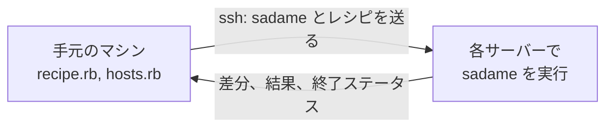

<p align="center"></p>

<p align="center"><a href="README.md">English</a> · <b>日本語</b></p>

<p align="center">
  <a href="https://github.com/enderkus/sadame/actions/workflows/ci.yml"></a>
  <a href="https://enderkus.github.io/sadame/"></a>
  <a href="https://github.com/enderkus/sadame/releases/latest"></a>
  <a href="LICENSE"></a>
  <a href="https://x.com/sadame_rb"></a>
</p>

<h3 align="center">素の Ruby で書く、単一バイナリの構成管理ツール</h3>

<p align="center">
Linux マシンのあるべき姿を Ruby で記述し、すべての変更を適用前に差分で確認して、<br> SSH 経由で適用します。サーバーには何もインストールする必要がありません。
</p>

<p align="center">
  <a href="https://enderkus.github.io/sadame/">ドキュメント（英語）</a> ·
  <a href="https://enderkus.github.io/sadame/getting-started/">はじめに</a> ·
  <a href="https://enderkus.github.io/sadame/examples/">例</a> ·
  <a href="CHANGELOG.md">変更履歴</a>
</p>

<p align="center"></p>

## sadame の特徴

- **素の Ruby。** レシピもインベントリも Ruby です。YAML やテンプレートの独自ルールではなく、ループ、条件分岐、メソッドがそのまま使えます。Ruby はバイナリに組み込まれているため、手元のマシンにもサーバーにも Ruby は不要です。
- **変更の前に、必ず差分を。** `plan` は何が変わるかを 1 行単位の差分で示し、何も変更しません。`apply` は違いのある部分だけを変更し、もう一度実行しても何も変わりません。
- **サーバーへのインストールは不要。** SSH、シェル、`tar` があれば十分です。sadame は実行のたびに自分自身を各サーバーへコピーし、実行後に常駐するプロセスは何も残りません。
- **小さな単一バイナリ。** 約 1.5 MB。Linux（x86_64、ARM64）と macOS に対応しています。
- **CI でドリフトを検出。** サーバーがレシピと一致しなくなると `drift` は終了ステータス 1 を返し、`report` はその結果を GitHub Actions のサマリーや JUnit のテスト結果に変換します。
- **慎重なロールアウト。** `--serial 1` で 1 台ずつ変更し、最初の失敗で止まります。`--tags` でレシピの一部だけを実行できます。
- **ミスを早めに発見。** `validate` はどのサーバーにも接続せずに、ホストごとにレシピを検査します。`sadame lsp` は同じエラーを、入力中のエディタに表示します。

## レシピの例

```ruby
package "nginx"
file "/var/www/html/index.html", content: "Hello from sadame\n", mode: "0644"
service "nginx", enable: true, state: :running
```

新しい Debian サーバーで `sudo sadame plan` を実行した結果です。

```text
+ package[nginx]
    state: absent -> installed

+ file[/var/www/html/index.html]
    state: absent -> present
    mode: 0644
    --- /dev/null
    +++ /var/www/html/index.html (desired)
    @@ -0,0 +1 @@
    +Hello from sadame

~ service[nginx]
    enabled: false -> true
    state: stopped -> running

Plan: 2 to create, 1 to update, 0 to remove, 0 to run, 0 unchanged.
```

`sudo sadame apply` は、まさにこれらの変更を行います。`sudo sadame drift` は、マシンがレシピと一致している間は 0 を返し、誰かが手作業でページを編集したり nginx を停止したりすると 1 を返します。

## 複数のサーバー

`hosts.rb` にグループ単位で列挙し、グループごと、ホストごとに変数（vars）を設定します。

```ruby
group :web do
  host "web1.example.com", user: "deploy", sudo: true
  host "web2.example.com", user: "deploy", sudo: true, vars: { workers: 8 }
  vars workers: 4
end

group :db do
  host "db1.example.com", user: "deploy", port: 2222, sudo: true
end
```

```sh
sadame plan site.rb -g web               # web サーバーで何が変わるか
sadame apply site.rb -g web --serial 1   # 1 台ずつ適用し、最初の失敗で止める
sadame drift site.rb -g all              # すべてのサーバーがまだ一致しているか
```

グループやマシンごとの判断は、レシピの中に素の Ruby で書けます。

```ruby
include_recipe "roles/web", tags: [:web] if host_groups.include?(:web)
file "/etc/app.conf", content: "workers = #{facts[:cpus] * 2}\n"
```

`examples/08-multi-role-inventory` は、この形をとった完全なプロジェクトです。

## 仕組み



sadame はあなた自身の `ssh` と `~/.ssh/config` で接続するため、ポート、鍵、踏み台サーバーの設定はこれまでどおりに使えます。sadame は自分自身をバージョンごとに一度だけ各サーバーへコピーし（SHA-256 チェックサムで検証）、レシピを送ってサーバー上で実行し、終了後にレシピを削除します。サーバーは並列に処理され、同時に処理する台数は `--forks` で制限できます。

## コマンド

| コマンド | 内容 |
|---|---|
| `sadame init` | プロジェクトを開始します。レシピ、vars、インベントリ、`--ci` を付ければ毎日のドリフトチェックも作成します。 |
| `sadame validate` | どのホストにも接続せずに、各ホストの vars でレシピを検査します。 |
| `sadame plan` | `apply` で何が変わるかを差分で示します。何も変更しません。 |
| `sadame apply` | レシピとの違いを変更します。 |
| `sadame drift` | マシンがレシピと異なると、終了ステータス 1 を返します。 |
| `sadame hosts` | 選択したホストを、接続オプションと vars とともに一覧表示します。 |
| `sadame facts` | 各ホストでレシピから見える情報（CPU、メモリ、アドレスなど）を表示します。 |
| `sadame report` | JSON レポートを、CI 向けの Markdown や JUnit XML に変換します。 |
| `sadame lsp` | 言語サーバーです。エディタでエラー表示、補完、ホバーによる説明を提供します。 |

## リソース

| リソース | 管理するもの |
|---|---|
| [`package`](https://enderkus.github.io/sadame/resources/package/) | パッケージ（apt、dnf、apk、pacman） |
| [`file`](https://enderkus.github.io/sadame/resources/file/) | ファイル：内容、ERB テンプレート、モード、所有者、置き換え前の検証 |
| [`line`](https://enderkus.github.io/sadame/resources/line/) | パッケージが所有するファイルの中の 1 行 |
| [`directory`](https://enderkus.github.io/sadame/resources/directory/) | ディレクトリ |
| [`link`](https://enderkus.github.io/sadame/resources/link/) | シンボリックリンク |
| [`service`](https://enderkus.github.io/sadame/resources/service/) | systemd と OpenRC のサービス（変更時の reload と restart を含む） |
| [`exec`](https://enderkus.github.io/sadame/resources/exec/) | コマンド（必要なときだけ実行するためのガード付き） |
| [`user`](https://enderkus.github.io/sadame/resources/user/) | ユーザーアカウント |
| [`group`](https://enderkus.github.io/sadame/resources/group/) | グループ |
| [`git`](https://enderkus.github.io/sadame/resources/git/) | タグ、ブランチ、コミットに合わせて保たれるチェックアウト |

## インストール

```sh
curl -fsSL https://raw.githubusercontent.com/enderkus/sadame/main/install.sh | sh
```

このスクリプトはシステムに合ったバイナリを選び、SHA-256 チェックサムを検証して `/usr/local/bin` にインストールします。Homebrew の場合は `brew install enderkus/sadame/sadame` です。続いてプロジェクトを始めます。

```sh
sadame init infra
sadame validate infra
sudo sadame plan infra
```

sadame は Linux と macOS で動作します。管理できるのは Debian、Ubuntu、Rocky Linux などの RHEL 系、Alpine、そして Omarchy を含む Arch Linux で、x86_64 と ARM64 に対応しています。CI はプッシュのたびに、これら 5 つのディストリビューションのコンテナですべての例を適用し、ドリフトがないことを確認しています。

## 類似ツールとの比較

| | Sadame | Ansible | Itamae | mitamae |
|---|---|---|---|---|
| レシピの言語 | Ruby | YAML と Jinja2 | Ruby | Ruby |
| 対象サーバーに必要なもの | SSH、シェル、`tar` | SSH と Python | SSH とシェル | 自分でコピーしたバイナリ |
| インベントリ | `hosts.rb`（Ruby） | INI または YAML、プラグイン | なし | なし |
| ドライラン | `plan`（差分付き） | `--check --diff` | `--dry-run` | `--dry-run` |
| CI 向けのドリフト検出 | `drift`（終了ステータス 1） | 専用コマンドなし | `--detailed-exitcode` | なし |
| ローリング変更 | `--serial` | `serial:` | なし | なし |
| JSON 出力 | `--json` | コールバックプラグイン | なし | なし |
| 配布形態 | 単一の静的バイナリ | Python パッケージ | Ruby gem | 単一バイナリ |
| 成熟度 | 0.5.0、10 種類のリソース | 2012 年から、数千のモジュール | 2013 年から | 2016 年から |

[詳しい比較](https://enderkus.github.io/sadame/comparison/)（英語）では Chef と Puppet も加え、sadame にまだできないことも挙げています。

## ドキュメント

**<https://enderkus.github.io/sadame/>**（英語）

- [はじめに](https://enderkus.github.io/sadame/getting-started/)：インストール、最初のレシピ、plan の読み方。
- レシピ：[基本](https://enderkus.github.io/sadame/recipes/basics/)、[インベントリ](https://enderkus.github.io/sadame/recipes/inventory/)、[ファクト](https://enderkus.github.io/sadame/recipes/facts/)、[タグ](https://enderkus.github.io/sadame/recipes/tags/)、[通知](https://enderkus.github.io/sadame/recipes/notifications/)。
- ガイド：[新しい VPS の構築](https://enderkus.github.io/sadame/guides/provision-a-new-vps/)、[CI でのドリフト検出](https://enderkus.github.io/sadame/guides/drift-in-ci/)、[チームでの運用](https://enderkus.github.io/sadame/guides/team-workflow/)、[Omarchy ワークステーション](https://enderkus.github.io/sadame/guides/omarchy-workstation/)、[エディタ対応](https://enderkus.github.io/sadame/guides/editors/)、[レシピの共有](https://enderkus.github.io/sadame/guides/sharing-recipes/)、[Ansible](https://enderkus.github.io/sadame/guides/migrate-from-ansible/) や [Itamae](https://enderkus.github.io/sadame/guides/migrate-from-itamae/) からの移行。
- [例](https://enderkus.github.io/sadame/examples/)：1 つのファイルだけの例から、堅牢化した VPS、PostgreSQL、ワークステーションまで、12 のプロジェクト。

## 現状

sadame は若いプロジェクトです。最初のリリースは 2026 年 11 月で、メンテナーは 1 人です。プッシュのたびに 5 つのディストリビューションでテストしていますが、本番環境での利用実績はまだ多くありません。バグ報告、リソースのアイデア、質問は [issues](https://github.com/enderkus/sadame/issues) へお寄せください。sadame 自体の開発に参加する場合は [CONTRIBUTING.md](CONTRIBUTING.md) を参照してください。

## 名前の由来

定め（さだめ）は、定められたこと、あるべき姿を意味する言葉です。sadame では、マシンがあるべき状態を指します。

## プロジェクトをフォロー

GitHub でスターを付けていただくと、ほかの人が sadame を見つけやすくなります。ニュースとリリース情報は X の [@sadame_rb](https://x.com/sadame_rb) で発信しています。

## ライセンス

[MIT](LICENSE)
