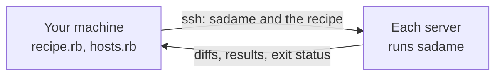

<p align="center"></p>

<p align="center"><b>English</b> · <a href="README.ja.md">日本語</a></p>

<p align="center">
  <a href="https://github.com/enderkus/sadame/actions/workflows/ci.yml"></a>
  <a href="https://enderkus.github.io/sadame/"></a>
  <a href="https://github.com/enderkus/sadame/releases/latest"></a>
  <a href="LICENSE"></a>
  <a href="https://x.com/sadame_rb"></a>
</p>

<h3 align="center">Configuration management in plain Ruby, in one binary.</h3>

<p align="center">
Describe what your Linux machines should look like in Ruby, see every change<br>
as a diff before it happens, and apply it over SSH, with nothing to install on the servers.
</p>

<p align="center">
  <a href="https://enderkus.github.io/sadame/">Documentation</a> ·
  <a href="https://enderkus.github.io/sadame/getting-started/">Getting started</a> ·
  <a href="https://enderkus.github.io/sadame/examples/">Examples</a> ·
  <a href="CHANGELOG.md">Changelog</a>
</p>

<p align="center"></p>

## Why sadame

- **Plain Ruby.** Recipes and the inventory are Ruby: loops, conditions and
  methods instead of YAML and templating rules. The Ruby is built in, so
  neither your machine nor the servers need one.
- **A diff before every change.** `plan` shows what would change, line by
  line, and changes nothing. `apply` changes only what differs, and running
  it again changes nothing.
- **Nothing to install on the servers.** SSH, a shell and `tar` are enough:
  sadame copies itself to each server for the run, and nothing keeps
  running afterwards.
- **One small binary.** About 1.5 MB, for Linux (x86_64, ARM64) and macOS.
- **Drift checks for CI.** `drift` exits with status 1 when a server no
  longer matches its recipe, and `report` turns the result into a GitHub
  Actions summary or JUnit test results.
- **Careful rollouts.** `--serial 1` changes one server at a time and stops
  at the first failure; `--tags` runs part of a recipe.
- **Mistakes caught early.** `validate` checks a recipe for every host
  without connecting to any, and `sadame lsp` shows the same errors in your
  editor as you type.

## A recipe

```ruby
package "nginx"
file "/var/www/html/index.html", content: "Hello from sadame\n", mode: "0644"
service "nginx", enable: true, state: :running
```

`sudo sadame plan` on a fresh Debian server:

```text
+ package[nginx]
    state: absent -> installed

+ file[/var/www/html/index.html]
    state: absent -> present
    mode: 0644
    --- /dev/null
    +++ /var/www/html/index.html (desired)
    @@ -0,0 +1 @@
    +Hello from sadame

~ service[nginx]
    enabled: false -> true
    state: stopped -> running

Plan: 2 to create, 1 to update, 0 to remove, 0 to run, 0 unchanged.
```

`sudo sadame apply` makes exactly those changes. `sudo sadame drift` exits
with 0 while the machine matches the recipe, and with 1 once someone edits
the page or stops nginx by hand.

## Many servers

List them in `hosts.rb`, in groups, with vars per group and per host:

```ruby
group :web do
  host "web1.example.com", user: "deploy", sudo: true
  host "web2.example.com", user: "deploy", sudo: true, vars: { workers: 8 }
  vars workers: 4
end

group :db do
  host "db1.example.com", user: "deploy", port: 2222, sudo: true
end
```

```sh
sadame plan site.rb -g web               # what would change on the web servers
sadame apply site.rb -g web --serial 1   # one at a time, stopping at the first failure
sadame drift site.rb -g all              # does every server still match?
```

Recipes decide per group and per machine, in plain Ruby:

```ruby
include_recipe "roles/web", tags: [:web] if host_groups.include?(:web)
file "/etc/app.conf", content: "workers = #{facts[:cpus] * 2}\n"
```

`examples/08-multi-role-inventory` is a complete project in this shape.

## How it works



Sadame connects with your own `ssh` and `~/.ssh/config`, so ports, keys and
jump hosts work as they already do. It copies itself to each server once per
version, checked by its SHA-256 checksum, sends the recipe along, runs it
there, and removes the recipe afterwards. Servers run in parallel; `--forks`
limits how many at once.

## Commands

| Command | What it does |
|---|---|
| `sadame init` | Starts a project: a recipe, vars, an inventory, and with `--ci` a daily drift check. |
| `sadame validate` | Checks a recipe for every host, with its vars, without connecting to any. |
| `sadame plan` | Shows what `apply` would change, as a diff. Changes nothing. |
| `sadame apply` | Changes what differs from the recipe. |
| `sadame drift` | Exits with 1 when a machine differs from its recipe. |
| `sadame hosts` | Lists the selected hosts with their connection options and vars. |
| `sadame facts` | Shows what recipes see on each host: CPUs, memory, addresses. |
| `sadame report` | Turns JSON reports into Markdown or JUnit XML for CI. |
| `sadame lsp` | A language server: errors, completion and hover text in your editor. |

## Resources

| Resource | Manages |
|---|---|
| [`package`](https://enderkus.github.io/sadame/resources/package/) | packages, with apt, dnf, apk or pacman |
| [`file`](https://enderkus.github.io/sadame/resources/file/) | files: content, ERB templates, mode, owner, a check before replacing |
| [`line`](https://enderkus.github.io/sadame/resources/line/) | one line in a file that a package owns |
| [`directory`](https://enderkus.github.io/sadame/resources/directory/) | directories |
| [`link`](https://enderkus.github.io/sadame/resources/link/) | symbolic links |
| [`service`](https://enderkus.github.io/sadame/resources/service/) | systemd and OpenRC services, with reload and restart on change |
| [`exec`](https://enderkus.github.io/sadame/resources/exec/) | commands, with guards so they run only when needed |
| [`user`](https://enderkus.github.io/sadame/resources/user/) | user accounts |
| [`group`](https://enderkus.github.io/sadame/resources/group/) | groups |
| [`git`](https://enderkus.github.io/sadame/resources/git/) | checkouts kept at a tag, a branch or a commit |

## Install

```sh
curl -fsSL https://raw.githubusercontent.com/enderkus/sadame/main/install.sh | sh
```

The script picks the binary for your system, checks its SHA-256 checksum
and installs it to `/usr/local/bin`. With Homebrew:
`brew install enderkus/sadame/sadame`. Then start a project:

```sh
sadame init infra
sadame validate infra
sudo sadame plan infra
```

Sadame runs on Linux and macOS. It manages Debian, Ubuntu, Rocky Linux and
other RHEL-like systems, Alpine, and Arch Linux including Omarchy, on
x86_64 and ARM64. On every push, CI applies every example in containers of
those five distributions and checks them for drift.

## Compared with similar tools

| | Sadame | Ansible | Itamae | mitamae |
|---|---|---|---|---|
| Recipes in | Ruby | YAML and Jinja2 | Ruby | Ruby |
| Targets need | SSH, a shell, `tar` | SSH and Python | SSH and a shell | the binary, copied by you |
| Inventory | `hosts.rb`, in Ruby | INI or YAML, plugins | none | none |
| Dry run | `plan`, with diffs | `--check --diff` | `--dry-run` | `--dry-run` |
| Drift check for CI | `drift`, exit status 1 | no dedicated command | `--detailed-exitcode` | no |
| Rolling changes | `--serial` | `serial:` | no | no |
| JSON output | `--json` | callback plugins | no | no |
| Distributed as | one static binary | Python package | Ruby gem | one binary |
| Maturity | 0.5.1, ten resource types | since 2012, thousands of modules | since 2013 | since 2016 |

The [full comparison](https://enderkus.github.io/sadame/comparison/) adds
Chef and Puppet, and lists what sadame does not do yet.

## Documentation

**<https://enderkus.github.io/sadame/>**

- [Getting started](https://enderkus.github.io/sadame/getting-started/): install, a first recipe, reading a plan.
- Recipes: [basics](https://enderkus.github.io/sadame/recipes/basics/), the [inventory](https://enderkus.github.io/sadame/recipes/inventory/), [facts](https://enderkus.github.io/sadame/recipes/facts/), [tags](https://enderkus.github.io/sadame/recipes/tags/), [notifications](https://enderkus.github.io/sadame/recipes/notifications/).
- Guides: [a new VPS](https://enderkus.github.io/sadame/guides/provision-a-new-vps/), [drift in CI](https://enderkus.github.io/sadame/guides/drift-in-ci/), [team workflow](https://enderkus.github.io/sadame/guides/team-workflow/), [an Omarchy workstation](https://enderkus.github.io/sadame/guides/omarchy-workstation/), [editor support](https://enderkus.github.io/sadame/guides/editors/), [sharing recipes](https://enderkus.github.io/sadame/guides/sharing-recipes/), migrating from [Ansible](https://enderkus.github.io/sadame/guides/migrate-from-ansible/) or [Itamae](https://enderkus.github.io/sadame/guides/migrate-from-itamae/).
- [Examples](https://enderkus.github.io/sadame/examples/): twelve projects, from one file to a hardened VPS, PostgreSQL and a workstation.

## Status

Sadame is young: its first release was in November 2026, and it has one
maintainer. It is tested on five distributions on every push, but has
little production use yet. Bug reports, ideas for resources and questions
are welcome in [issues](https://github.com/enderkus/sadame/issues); see
[CONTRIBUTING.md](CONTRIBUTING.md) to work on sadame itself.

## The name

定め (*sadame*) is Japanese for what has been decided, or what is meant to
be: here, the state a machine is supposed to be in.

## Follow the project

A star on GitHub helps other people find sadame. News and releases are
posted on X as [@sadame_rb](https://x.com/sadame_rb).

## License

[MIT](LICENSE)
