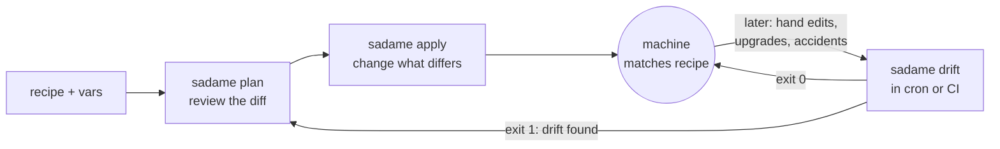

# Plan, apply, drift

Sadame has three commands that work on the same comparison: for every
resource in the recipe, read the current state from the machine, compare it
with the desired state, and report the difference. `plan` shows the
difference, `apply` removes it, and `drift` tells you, through its exit
status, whether there is any difference left. Used together they form a
loop: plan a change, apply it, and later check that the machine has not
wandered away from the recipe.



## When to use which

| Command | Changes the machine | Use it to | Exit status |
|---|---|---|---|
| `plan` | no | review what a recipe or var change would do before applying it | `0` whether or not there are changes |
| `apply` | yes | converge the machine: change only what differs, then run notifications | `0` when everything succeeded, `1` when something failed |
| `drift` | no | check, from a script, cron job or CI pipeline, that the machine still matches | `0` no difference, `1` difference found |

All three exit with `2` when the command line or the recipe is wrong.
`plan` and `drift` also exit with `2` when they could not read the state of
some resource, because they then cannot tell whether it matches:

| Status | `plan` | `apply` | `drift` |
|---|---|---|---|
| `0` | plan computed | every resource and notification succeeded | machine matches the recipe |
| `1` | not used | a resource or notification failed | machine differs from the recipe |
| `2` | usage or recipe error, or a state could not be read | usage or recipe error | usage or recipe error, or a state could not be read |

`plan` and `drift` produce the same report; only the summary line and the
exit status differ. Both accept `--json` (see the
[JSON output reference](../reference/json-output.md)).

## The loop on a real machine

The example recipe installs nginx, adds a system user, writes a
configuration file and keeps nginx running:

```ruby title="examples/10-drift-demo/recipe.rb"
--8<-- "examples/10-drift-demo/recipe.rb"
```

### Apply

```text
--8<-- "docs/transcripts/drift-demo-apply.txt"
```

### Drift right after apply

```text
--8<-- "docs/transcripts/drift-demo-clean.txt"
```

### Something changes the machine

`break-things.sh` does what happens to servers over time: someone edits a
setting by hand, loosens a file's permissions while debugging, and stops a
service.

```sh title="examples/10-drift-demo/break-things.sh"
--8<-- "examples/10-drift-demo/break-things.sh"
```

```text
--8<-- "docs/transcripts/drift-demo-break.txt"
```

### Drift catches it

Three changes on two resources: the file's content and mode, and the
service state. The exit status is `1`.

```text
--8<-- "docs/transcripts/drift-demo-drift.txt"
```

### Apply puts it back

```text
--8<-- "docs/transcripts/drift-demo-repair.txt"
```

## What drift sees, and what it does not

Drift compares only what the recipe declares, attribute by attribute:

- A file's content, mode, owner and group, but only those you set. A file
  declared without `mode:` can change mode without drift.
- Packages, by name: an installed package of any version matches
  `state: :installed`.
- Services: only `enable:` and `state:`, when given.
- `exec` resources: the guard decides. An `exec` whose guard says it must
  run counts as drift, and an `exec` without any guard always does.
- Anything not in the recipe is invisible: files nobody declared, extra
  packages, extra users.

## Common mistakes

- **Unguarded `exec` resources.** They make `drift` exit `1` forever. Give
  every `exec` a guard, or `action: :nothing` if it only runs when
  notified.
- **Running drift without root.** Files only root can read cannot be
  compared; those resources fail and `drift` exits `2`, not `1`.
- **Treating `plan`'s exit status as drift.** `plan` exits `0` even when
  there are changes. Scripts that need a yes/no answer use `drift`.
- **Expecting drift to repair.** `drift` never changes anything. Run
  `apply` to converge, after reviewing the diff.

## See also

- [Drift in CI](../guides/drift-in-ci.md): run `drift` on a schedule.
- [JSON output](../reference/json-output.md): the report format.
- [Notifications](../recipes/notifications.md): what `apply` runs after a
  change.
