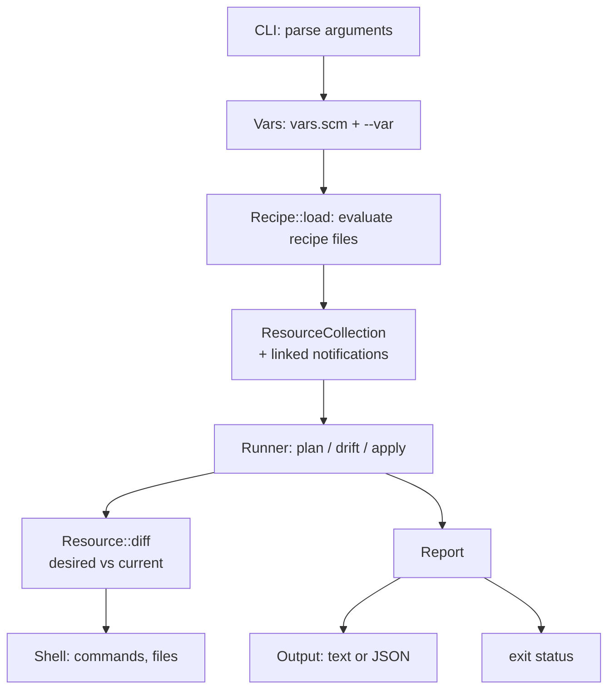

# Architecture

Sadame is a C++17 program with GNU Guile Scheme embedded. The logic, from
the command line to the resources, is C++; the languages users write
recipes, `hosts.scm` and `vars.scm` in are Guile Scheme, and so are the few
Scheme modules that define what those files can call. Everything is
compiled into one executable. This page maps the code, follows one run
through it, explains where C++ and Scheme meet, and walks through the two
most common extensions: a new resource and a new package manager.

## Module map

All code lives in `lib/sadame/`. Each module is a `.hpp` and a `.cpp`; the
Scheme modules are `.scm` files that the build compiles into the binary.

| File | Responsibility |
|---|---|
| `cli.cpp` | Parses arguments, loads vars, the inventory and the recipe, runs a command, returns the exit status. `tools/sadame/sadame.cpp` calls it from `main`. |
| `scheme.cpp` | The bridge to Guile: starts it, loads the embedded modules, converts Scheme values to `Value` and back, and defines the primitives (`%declare`, `%vars`, `json-parse`, ...) the Scheme modules call. |
| `eval.scm` | Reads and evaluates a Scheme file form by form, catching every error and returning it as data with the line it happened on. Also `source-directory` and `read-text-file`. |
| `recipe.scm`, `recipe.cpp` | The recipe language. `recipe.scm` defines `package`, `file`, ..., `include-recipe`, `vars`, `platform`, `facts`; they call the primitives, which call `Recipe` in C++. |
| `inventory.scm`, `inventory.cpp` | The `hosts.scm` language (`group`, `host`, `vars`, `command-output`), groups and includes, and selecting targets with `-h`, `-g` and `--limit`, including each target's merged vars. |
| `vars.scm`, `vars.cpp` | Loads `vars.scm`, parses `--var`, merges layers. |
| `template.cpp`, `template.scm` | The template engine: `~{...}` tags with Scheme expressions, `~(if)`, `~(each)`, and the names expressions can use. |
| `value.cpp` | `Value`: the dynamic value (nil, boolean, number, string, symbol, list, ordered map) that options, vars, facts and reports are made of. |
| `resource_collection.cpp` | The ordered resources of a run, duplicate detection, and the notification index. |
| `resource.cpp` | Base class: option validation, `desired` / `current` / `diff` / `apply`, notification actions, and `make_resource`, which creates a resource from its type name. |
| `resources/*.cpp` | One class per resource type. |
| `notification.cpp` | Parses `#:notifies` and `#:subscribes` entries. |
| `selection.cpp` | `--tags` and `--skip-tags`. |
| `runner.cpp` | Runs `plan`, `drift` and `apply` over a collection; queues and runs notifications. |
| `report.cpp` | The result of a run: entries, notification runs, counts, exit status, JSON shape. |
| `output.cpp` | Renders a report as text (as it happens) or as JSON (at the end). |
| `diff.cpp` | Attribute changes and unified diffs (Myers' algorithm). |
| `host.cpp` | The machine being configured: its shell plus facts read once (platform, package manager, service manager). |
| `facts.cpp` | `(facts 'cpus)` and friends, each read from the machine the first time it is asked for. |
| `platform.cpp` | Reads `/etc/os-release`; maps distributions to families and package managers. |
| `package_managers/*.cpp` | apt, dnf, apk and pacman: the command lines for query, install and remove. |
| `path_stat.cpp` | Type, mode, owner and group of a path, from `stat`. |
| `shell.cpp` | The only place commands run and files are read or written. |
| `json_writer.cpp` | JSON generation and parsing. |
| `scheme_literal.cpp` | Writes values as Scheme source, for `sadame hosts`. |
| `target.cpp`, `glob.cpp` | A host to run on, parsing `[user@]host[:port]`, and `*` / `?` matching for `--limit`. |
| `hosts_listing.cpp`, `facts_listing.cpp` | The output of `sadame hosts` and `sadame facts`. |
| `stand_in.cpp`, `validation.cpp` | `sadame validate`: a made-up machine that refuses commands, and the checks run against it. |
| `scaffold.cpp` | `sadame init`. |
| `errors.cpp` | Error classes and the `file:line` of a recipe error. |

## One run, step by step



1. `CLI` parses the arguments and finds the recipe and `vars.scm`.
2. `Recipe::load` hands the recipe's text to Scheme (`eval.scm`), which
   evaluates it form by form in a module of its own. Each `(file ...)`,
   `(package ...)` and so on calls a primitive, which builds a resource.
   The resource validates its options right away and is added to the
   `ResourceCollection`. After the last file, the collection links
   notifications and checks that every target exists.
3. `Runner` walks the collection. For each resource it calls `diff`, which
   compares `desired` with `current`. `current` reads the machine through
   the `Shell` of the `Host`; nothing else touches the system.
4. For `apply`, a non-empty diff is passed to the resource's `apply`, and
   the notifications it triggers run immediately or are queued.
5. Each result goes to a `Report` and to the `Output`, which prints text as
   the run progresses or JSON at the end. `Report::exit_status` becomes the
   process exit status.

## Where C++ and Scheme meet

Scheme code never touches the machine and C++ never reads a user's
Scheme directly; they only meet in `scheme.cpp`.

- **Values.** Scheme data becomes a `Value`: strings, symbols, numbers,
  booleans, lists, and association lists as ordered maps. The first entry
  for a name wins, as with `assoc`. Keywords and symbols used as names
  have their dashes turned into underscores, so `#:not-if` and `#:not_if`
  are the same option and `(vars 'site-name)` finds `site_name`. Options
  that are always lists (`#:notifies`, `#:groups`, `#:tags`, ...) are read
  as lists even when they look like an association list.
- **Primitives.** `scheme.cpp` defines the functions Scheme calls into C++.
  Each body runs inside `guarded()`, which catches every C++ exception,
  destroys the frames that threw, and only then raises a Scheme error that
  carries the error's class and message. A C++ exception must never travel
  through Guile's frames, and a Scheme error must never travel through
  C++'s: `longjmp` skips destructors.
- **Errors.** `evaluate-source` catches everything a file can throw and
  returns `(error kind message line)`. `scheme::evaluate_file` turns that
  into a `RecipeError` that starts with `file:line`. A misspelled option is
  reported on the line that names it, not on the line where the call
  starts.
- **Embedding.** `lib/sadame/*.scm` are compiled into the binary by the
  `Makefile` as string literals and evaluated when Guile starts. Each file
  is one Guile module: `(sadame recipe)`, `(sadame inventory)`,
  `(sadame vars)`, `(sadame template)` and `(sadame eval)`. A recipe is
  evaluated in a fresh module that has the bindings of `(sadame recipe)`
  defined in it, so it can shadow Guile's own names such as `link`.

Rules for code in `lib/`:

| Do not | Because | Instead |
|---|---|---|
| Call Guile functions outside `scheme.cpp` | the bridge is where errors and values are converted | add a primitive there |
| Let an exception escape a primitive | it would unwind through Guile's frames | wrap the body in `guarded()` |
| Run commands or read files of the managed machine with `std::ifstream`, `popen` or `system` | tests could not replace them; `validate` could not refuse them | `Shell::run`, `Shell::run_checked`, `Shell::read_file`, `Shell::write_file` |
| Print from a resource | text output is `Output`'s job | return changes and errors |
| Format a `Value` for users with `inspect()` casually | it writes Scheme syntax | write the message explicitly |

Files of the recipe itself (templates, `#:source` files, other recipes, vars)
are read with plain file I/O, because they belong to the person running
sadame, not to the machine being configured.

## Adding a resource

This section builds a `cron` resource that manages one job as a file in
`/etc/cron.d`. Sadame does not ship it; the code below is kept in
`test/unit/tutorial_cron_test.cpp`, where it is compiled and tested like the
real resources.

### 1. Decide what the desired state is

A resource is a set of attributes whose current value can be read and
compared. For a cron job that is whether the file exists (`state`) and its
exact text (`content`). Using the attribute name `content` means plan output
and JSON show changes as a unified diff, like the `file` resource does.

### 2. Write the class

In a real change this goes into `lib/sadame/resources/cron.hpp` and
`cron.cpp`:

```cpp
--8<-- "test/unit/tutorial_cron_test.cpp:resource"
```

What the base class does for you:

- `allowed_options` is checked when the recipe loads: an unknown option
  fails before anything runs. `#:notifies`, `#:subscribes` and `#:tags` are
  always allowed.
- `validate` runs right after, for option values. The helpers
  `validate_choice`, `validate_boolean`, `validate_mode` and
  `validate_verify` cover the usual cases.
- `diff` compares `desired` with `current`, attribute by attribute. Only
  keys present in `desired` are compared.
- `plan_action` turns a `state` change from `"absent"` into a create and a
  change to `"absent"` into a remove.
- `apply` is only called with a non-empty diff.

Two rules to keep: read the machine only through `shell()` (never
`std::ifstream` directly), and make `apply` change only what differs.

### 3. Register it

Add the sources to nothing: the `Makefile` compiles every `.cpp` under
`lib/`. Teach `make_resource` and `resource_types` in
`lib/sadame/resource.cpp` the new type, and add the DSL procedure to
`lib/sadame/recipe.scm`:

```cpp
// lib/sadame/resource.cpp, in make_resource
else if (type == "cron") resource = std::make_unique<CronResource>(name, options, host, source_dir, vars);
```

```scheme
;; lib/sadame/recipe.scm, in the export list and below
(define (cron name . options) (%declare 'cron name options))
```

A recipe can now declare cron jobs:

```scheme
(cron "backup" #:schedule "0 3 * * *" #:command "/usr/local/bin/backup")
(cron "cleanup" #:schedule "*/15 * * * *"
      #:command "find /tmp/app -mtime +1 -delete" #:user "app")
```

### 4. Test it without root

Tests run against `FakeShell`, which records commands and keeps files in
memory, so they need no root and touch nothing. Cover creating, the
no-change case, an update, removal and validation:

```cpp
--8<-- "test/unit/tutorial_cron_test.cpp:tests"
```

Run `make test` to build and run them.

### 5. Document it

1. Write `docs/resources/cron.md` in the feature page shape: what and why,
   minimal example, option table, scenarios, common mistakes, see also.
2. Put every recipe the page shows in a new `cron` directory under
   `examples/resources/` and add it to the example matrix in
   `test/support/example_matrix.hpp`.
3. Add the page to `mkdocs.yml` and an entry to `CHANGELOG.md`.

## Adding a package manager

This section adds zypper, for openSUSE. Like the cron resource, the code is
kept in `test/unit/tutorial_zypper_test.cpp`.

### 1. Write the class

A package manager only provides three command lines; `Base` runs them and
turns exit statuses into results. In a real change this goes into
`lib/sadame/package_managers/zypper.hpp` and `zypper.cpp`:

```cpp
--8<-- "test/unit/tutorial_zypper_test.cpp:manager"
```

Override `installed` when the query's exit status is not enough, as `Apt`
does with `dpkg-query`, and `install` when the index needs refreshing, as
`Apt` does with `apt-get update`.

### 2. Register it

- Add a branch for `"zypper"` to `for_platform` in
  `lib/sadame/package_managers.cpp` and the name to `all()`.
- Teach `Platform` the family: add
  `{"suse", {"opensuse-leap", "opensuse-tumbleweed", "sles"}}` to
  `kFamilyIds` and `{"suse", "zypper"}` to `kPackageManagers` in
  `lib/sadame/platform.cpp`.

### 3. Test it

Add the distribution's real `/etc/os-release` as a fixture under
`test/fixtures/os-release/` (copy it from the official container image) and
a platform test for it. Then test the exact command lines:

```cpp
--8<-- "test/unit/tutorial_zypper_test.cpp:tests"
```

### 4. Document it

Add a row to the command table in `docs/resources/package.md` and update
`CHANGELOG.md`.

## Not ported yet

The Ruby sources of three features are still in the tree, unbuilt, as the
reference for porting them: push mode over SSH (`lib/sadame/push/`), the
language server (`lib/sadame/lsp/`) and `sadame report`
(`lib/sadame/report_formats.rb`). Their commands print that they are not
available yet. The Ruby tests under `test/unit/push/`, `test/unit/lsp*`
and `test/unit/report_formats_test.rb` describe the behaviour to keep, and
`test/integration/` and `script/` are Ruby tooling that has not been
adapted either.

## Common mistakes

- **Reading files with `std::ifstream` in a resource.** It works in
  production, but tests then read your machine instead of `FakeShell`. Use
  `shell().read_file`.
- **Letting an exception reach Scheme.** Put new primitives inside
  `guarded()`; see above.
- **Comparing a `Value` of one kind with another.** `Value("0644")` and a
  symbol with the same text are different. Resources compare strings, so
  turn options into text with `to_s()` before putting them in `desired`.
- **Changing output without updating the tests.** Plan, apply and JSON
  output are matched by `test/unit/runner_test.cpp` and
  `test/unit/cli_test.cpp`.

## See also

- [Building sadame](building.md)
- [Contributing](index.md)
